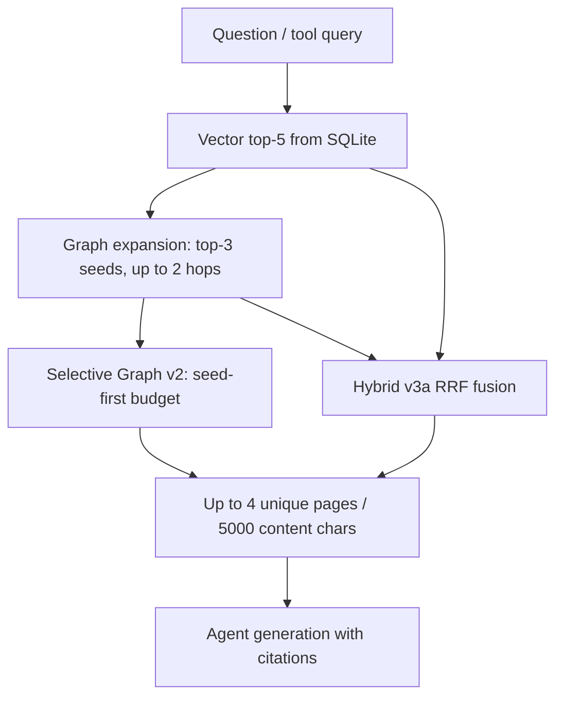

# Lecture 05 Answers

**Submission level:** Advanced (with Implementation as supporting work).
**Branch:** `lec05` (work completed in GitHub Codespaces).
**Study type:** Within-course case comparison and exploratory, development-only retrieval diagnostics; no population-level claim.

## Exercises

- **Course:** Practical AI Engineering Pilot Course 2026 — Lecture 05, *Foundation Models and Data / Retrieval*.
- **Answering model:** `gemini-3.5-flash-lite` (as printed by the execution traces).
- **Main comparison question (Q1):** “In Lecture 02, what does LoRA freeze and what does it train? What does QLoRA add?”
- **Target materials and scope:** The vector, Tree, and Graph paths use the bundled index and hierarchy for **214 pages from the main materials of Lectures 01–03**. Full Context supplies **8 documents / 398 pages**, including additional exercises. The corpus scope is therefore **not fully aligned** between Full Context and the retrieval methods. Results are documented as observed, not interpreted as a controlled comparison of only the retrieval algorithm.
- **Conditions:** Same user-facing question and answering model for each method within a case; the model chose each search-tool query. One recorded generation was collected per method/case in each comparative series. The later four-pair development run used one successful generation per method and question. No population accuracy rate, uncertainty interval, or causal improvement is claimed.
- **Metrics:** `[time]` includes retrieval and query embedding where applicable. `[usage]` totals tokens across all model responses. `[cost]` estimates **generation API cost only**; query embeddings, building the existing index, infrastructure, and human labor are excluded. Amounts are USD.
- **Baseline agent:** `search_materials` was the only registered tool in the default agent for this experiment. The Lecture 03 `make_quiz()` implementation was preserved in `app/tools.py`, but its registration was disabled on branch `lec05` to avoid altering the Day 5 baseline.

### Results by Method — Q1: LoRA and QLoRA

| Method | Key points and correctness of the answer | Cited pages and evidence | Time (s) | Input / output tokens | Model responses | Estimated generation API cost (USD) |
|---|---|---|---:|---:|---:|---:|
| Full Context | **Correct.** LoRA freezes pretrained base weights and trains the small low-rank matrices; QLoRA also quantizes the frozen base weights to 4 bits. | Lecture 02, Japanese source pp. 51–52; p. 52 corresponds to translated PDF p. 75. | 2.13 | 95,824 / 168 | 1 | 0.029167 |
| Vector / Basic RAG | **Correct, direct.** Explained frozen weights `W`, trainable matrices `A` and `B`, and 4-bit quantization. | Lecture 02, pp. 51–52; first search hit was `lec02-main-p052`. | 2.43 | 2,758 / 195 | 2 | 0.001315 |
| Tree | **Correct.** Reached the relevant section and read the full text of p. 52. Added an illustrative analogy that was not needed to answer. | Lecture 02, p. 52 (`lec02-main-p052`). | 4.60 | 9,442 / 381 | 5 | 0.003785 |
| Graph | **Correct.** Identified the trainable low-rank delta and 4-bit quantization. | Lecture 02, pp. 51–52; answer cited `lec02-main-p052`. | 3.04 | 5,187 / 278 | 2 | 0.002251 |

**Search alone:** `uv run python -m app.retrieval "LoRA QLoRA difference"` returned these five pages, in order:

1. `lec02-main-p052` — *LoRA and QLoRA: adapting a large model on one GPU* (**direct evidence**).
2. `lec02-main-p051` — *PEFT: train only part of a model* (**direct evidence**).
3. `lec02-main-p060` — *Today's exercise: correct output format with QLoRA and measure the effect* (related exercise; not required for the answer).
4. `lec02-main-p047` — *Evidence and debate: RAG often works better for adding knowledge* (related fine-tuning context; not required).
5. `lec02-main-p061` — *Exercise steps and deliverables — tentative* (related exercise; not required).

The text in p. 52 states that the original weights `W` are frozen while the small matrices `A` and `B` are trained. QLoRA stores the frozen base weights in a 4-bit representation. Thus the first two search hits were sufficient; the other three mainly increased background context.

**Tool calls and navigation:**

- Full Context: one generation with the supplied materials; prompt contained **369,491 characters**. No retrieval tool call.
- Vector: one `search_materials({'query': 'LoRA freeze train QLoRA add'})` call, with two model responses total.
- Tree: four `browse_tree` calls, following the path root → `lec02-main` → `lec02-main-s045` → `lec02-main-p052`.
- Graph: one `search_graph({'query': 'Lecture 02 LoRA freeze train QLoRA'})` call. The standard Graph method uses up to three vector seeds, two graph hops, and ten returned pages.

**Interpretation:** Basic RAG was sufficient for this focused question. Relative to Full Context, it used approximately **97.1% fewer input tokens** and had **95.5% lower estimated generation cost**. Full Context was slightly faster in this one run (2.13 versus 2.43 s); this does not establish a general latency advantage. Tree and Graph both found the answer but had higher token consumption and costs than Basic RAG.

### Additional question Q2 — Evidence spanning pages

**Question:** “In the Lecture 03 examples, how does compaction differ from memory across sessions? Do all daily notes go into long-term memory?”

**Evidence criteria:** Lecture 03 p. 39 explains compacting history within the active session versus external memory carried across sessions; p. 40 describes filtering daily notes before promotion to persistent long-term memory. Page 13 and the supplement p. 65 provide relevant additional context. The answer must explicitly say **not all daily notes are promoted**.

| Method | Answer and evidence assessment | Time (s) | Input / output tokens | Model responses | Cost (USD) |
|---|---|---:|---:|---:|---:|
| Vector / Basic RAG | **Complete and direct:** compaction operates within a session; external memory persists across sessions; the nightly review filters daily notes and preserves only selected information. Cited pp. 39–40, 65. | 2.74 | 2,297 / 316 | 2 | 0.001479 |
| Tree | **Evidence found, answer indirect:** navigated to the relevant pages but mainly asked the learner to inspect them instead of explicitly answering. | 5.31 | 8,278 / 363 | 6 | 0.003391 |
| Graph | **Evidence found, answer partly indirect:** distinguished compaction and memory, but treated daily-note filtering mainly as a prompt for the learner to think about. | 2.41 | 4,879 / 271 | 2 | 0.002141 |

Tree used five calls: `browse_tree({})`, then `lec03-main`, `lec03-main-s037`, `lec03-main-p039`, and `lec03-main-p040`. Graph used one `search_graph` call. Basic RAG was the most economical and provided the most complete direct answer in the observed runs. This is an important example of **retrieved evidence being available but not fully used in the final answer**.

### Additional question Q3 — Information absent from the lecture materials

**Question:** “What are the measured average response time and accuracy of the RAG system we just built?”

**Expected evidence-based behavior:** The Lectures 01–03 materials do not contain a measured performance report for the user's newly built system. The agent should decline to invent numbers. This is an **unanswerable-from-the-corpus** test, not a claim that no real-world performance measurements exist.

| Method | Answer and evidence assessment | Time (s) | Input / output tokens | Model responses | Cost (USD) |
|---|---|---:|---:|---:|---:|
| Vector / Basic RAG | **Appropriate abstention.** Explained that the materials do not supply the requested measurements. | 3.30 | 3,001 / 241 | 2 | 0.001503 |
| Tree | **Appropriate abstention.** Found no relevant measurements in the reviewed lecture structure. | 3.32 | 6,319 / 157 | 5 | 0.002288 |
| Graph | **Appropriate abstention.** Did not fabricate an average or accuracy percentage. | 2.32 | 4,931 / 192 | 2 | 0.001959 |

In this case, adding retrieval complexity did not improve the evidence-based outcome. The lack of a performance report needs to remain explicit.

### Baseline observations and method choice

1. **Data representation:** One page is one retrieval chunk. `lectures.json` stores document/section/page text and metadata; `index.sqlite3` stores page-level embeddings; `tree.json` supports hierarchical navigation; `graph.json` stores pages, shared terms and adjacency relationships. Page IDs and citation labels permit evidence checks.
2. **Retrieval and generation are separate failure points:** The LoRA pages were retrieved correctly by every approach; Q2 showed that navigating to the correct pages does not force a direct answer.
3. **Instruction effect:** The official `INSTRUCTIONS`, `TREE_INSTRUCTIONS`, and `GRAPH_INSTRUCTIONS` encourage guiding learners with hints rather than providing homework answers directly. This may affect answer directness. The instruction variants are a confound when comparing Basic RAG against Tree/Graph, so cost and quality differences cannot be attributed solely to retrieval.
4. **Preferred default for these questions:** Basic vector RAG. It gave direct, grounded answers for the two answerable questions, abstained when evidence was absent, and incurred the lowest estimated generation cost among the standard retrieval methods in all three cases.
5. **Limits:** There is only one observed run per case and method; model outputs may vary. Full Context has a larger corpus scope. The estimates exclude embedding costs. No formal benchmark-level accuracy, statistical significance, or hardware-normalized latency claim is made.

## Homework

**Level attempted: Implementation and Advanced.** Completion of either alone satisfies the assignment's one-level requirement. Both were performed to investigate whether expansion and selective graph retrieval improve evidence coverage efficiently.

### Implementation — Adjacent-page retrieval

**Goal:** Given the five nearest vector pages, also return their immediate predecessor and successor within the same source document, avoiding duplicate pages and preserving citation metadata.

**Files:**

- `app/retrieval.py`: added `search_with_neighbors(query, radius=1)` while leaving the original `search()` unchanged.
- `scripts/day5_adjacent_agent.py`: independent experimental agent with a tool named `search_materials` and comparable baseline instructions.
- `tests/test_day5_adjacent.py`: automated checks for document boundaries and deduplication.

**Method:** Load document pages, use the vector result `page_id` to find its position in that document's page list, append available adjacent pages, keep vector hits first, and label every returned page with `retrieval_origin` (`vector` or `adjacent`). Neighbors are not falsely assigned a vector similarity distance. The change does **not** rebuild or modify the index.

**Offline verification:** For the LoRA query, the five vector hits expanded to **11 unique pages**, containing **11,464 text characters** in total. The additional pages included Lecture 02 pp. 46, 48, 50, 53, 59 and 62. These provided background on fine-tuning but were not required to distinguish LoRA from QLoRA.

#### Implementation results versus the original Basic RAG

| Case | Basic RAG: time / tokens in / cost | Adjacent: time / tokens in / cost | Outcome |
|---|---|---|---|
| LoRA / QLoRA | 2.43 s / 2,758 / $0.001315 | 3.94 s / 5,039 / $0.002024 | Both correct; added pages did not improve the substantive answer. |
| Memory across sessions | 2.74 s / 2,297 / $0.001479 | 2.13 s / 4,434 / $0.001980 | Both complete; extra input tokens and cost despite a lower observed runtime. |
| Information absent | 3.30 s / 3,001 / $0.001503 | 4.04 s / 17,017 / $0.004645 | Both abstained. Adjacent variant performed **two** search calls instead of one, amplifying context use. |

All three Implementation evaluations used the same original user questions and model. Extra pages did not improve correctness for these cases. The absence case was particularly costly: input tokens increased from 3,001 to 17,017. This is an example of **unnecessary context expansion**, not a retrieval failure or a model hallucination. With an answerable question whose needed evidence falls on an adjacent page omitted from the vector top five, expansion might help, but no such improvement was demonstrated in these runs.

### Advanced — Budgeted selective Graph retrieval

**Chosen problem:** The original Graph method can include up to ten pages, increasing input-token consumption. We wanted to reduce irrelevant graph expansion while retaining pages supporting answers that span multiple pages or lectures.

**Architecture and changes:**

- `app/advanced_retrieval.py`: adds `select_graph_candidates(query, graph, max_pages=4, max_content_chars=5000)` and `search_graph_selective(query)`.
- `scripts/day5_selective_graph_agent.py`: executes the alternative retrieval method using the original `GRAPH_INSTRUCTIONS`, maintaining Graph's tool name `search_graph` and its return shape (`seeds`, `expanded`, `max_hops`).
- `tests/test_day5_selective_graph.py`: covers relevance, deduplication/citation preservation, budget enforcement and priority retention of primary evidence.

The approach uses the **same original Graph candidate generator**, which starts with vector similarity and expands through adjacent-page/shared-term relationships. The new deterministic selector deduplicates `page_id`s, retains citation metadata, and limits the supplied context to **four pages and 5,000 characters of page content per search-tool call**. It uses English lexical overlap as a lightweight signal to choose additional graph candidates. This is a retrieval-layer change; no LLM reranking and no re-embedding are performed.

#### Data structures, storage and retrieval design (Advanced requirement)

The improvement is implemented in the **retrieval layer** rather than by changing the model weights or re-embedding documents. The original course data structures remain the common source of truth:

| Artifact | Storage/data structure | Role in retrieval and verifiability |
|---|---|---|
| `data/rag_data/lectures.json` | Nested JSON: document → section → page (214 indexed main-lecture pages; 398 pages/8 documents in all supplied materials) | `load_pages()` flattens supported main documents into page dictionaries containing `page_id`, `document_id`, `lecture`, `section`, `title`, `page`, `content` and optional `citation`. A **single page is a single chunk**. |
| `data/rag_data/index.sqlite3` | SQLite `chunks` table with page metadata, text and serialized embedding BLOB | Vector similarity over the original precomputed **768-dimensional float32** representations (`gemini-embedding-001`); query embedding is computed for retrieval. The original DB was not rebuilt. The implementation uses `sqlite-vec` cosine distance or the tested Python distance-function fallback when extension loading is unavailable. |
| `data/rag_data/tree.json` | Hierarchical tree of documents, sections and pages | `browse_tree(node_id)` navigates an outline and short previews, then reads a page's full text. This supports directed browsing but can require several tool turns. |
| `data/rag_data/graph.json` | Node/edge adjacency graph: page nodes, term nodes and `next_page`/`mentions` relations | `search_graph()` starts with **top-3 vector seeds** and expands at most **2 hops** to a **10-page** output. A page → term → page path is two hops. Shared terminology is not automatically evidence of answer relevance. |
| `app/advanced_retrieval.py` | Deduplicated candidate map keyed by `page_id`, ranked seed list, graph expansion list and deterministic budgeted selector | **Selective Graph v2** keeps ranked seed evidence first when it fits, then chooses expansions by lexical coverage, respecting **4 unique pages / 5,000 page-content characters per tool call** and preserving citation/path metadata. |
| `app/hybrid_retrieval.py` | Candidate dictionary keyed by `page_id`, with `vector_rank`, `graph_rank`, RRF score and page metadata | **Hybrid v3a**, an exploratory extension, fuses top-5 Vector results with Graph candidates by `score(d) = 1/(60+r_vector(d)) + 1/(60+r_graph(d))` (a missing rank contributes zero). It reuses the vector embedding, deduplicates and applies the same 4-page/5,000-character budget. |
| `data/day5_benchmark/questions.json` and `scripts/day5_benchmark.py` | Annotated JSON cases, append-only run JSONL and SHA-256 code/material fingerprints | Controlled, reproducible **retrieval-only** and **generation** records. Four development cases were used for method decisions; sixteen holdout cases were left unrun during tuning. |

**Processing flow:** `question → query embedding → Vector top-5 → Graph top-3 seed expansion → selector (v2 seed-first or v3a RRF) → page texts and citation metadata → Pydantic-AI agent/tool response → answer`. The Tree path is a separate hierarchy-navigation alternative; Full Context passes a substantially larger corpus without a retrieval call. The v3a `search_graph(query, initial_hits=vector_hits)` integration shares the initial result to avoid duplicate query embeddings. In all methods, the model can choose a different search-query string from the user's original question; context budgets apply **per tool call**, not necessarily to the whole run.

**Architecture sketch (the two experimental paths share the source corpus and precomputed index):**



**Why these choices?** Page granularity preserves provenance and readable slide citations; SQLite avoids changing the bundled training materials/index; graph adjacency can add context not contained in the vector seed; deterministic selection is testable, avoids a second LLM reranking cost, and constrains prompt growth. RRF was tested specifically to address the case where Graph's top-3 starting points lost the **fourth vector result** needed for a cross-lecture comparison. The architecture must be evaluated against a simple vector baseline rather than assuming more components mean better retrieval.

**Reference integrity:** Page metadata is carried through each selection, and duplicate IDs are dropped before enforcing budgets. Gold/reference IDs are **not used to rank or select** candidates; they are read only during evaluation. Text-length limits count page content, not the model's full prompt/tool protocol overhead. Changes to generation instructions were intentionally avoided during the comparisons.

#### Advanced v1: initial selector and observed failure

Version 1 reserved the strongest vector seed, then greedily selected pages based on new query-term coverage, title overlap, and graph proximity. It lowered tokens for answerable questions but failed to preserve a primary source in the memory case.

| Case | Graph original: time / input tokens / cost | Selective Graph v1: time / input tokens / cost | Outcome |
|---|---|---|---|
| LoRA / QLoRA | 3.04 s / 5,187 / $0.002251 | 2.79 s / 2,555 / $0.001416 | Correct in both, with a lower cost in v1. |
| Memory across sessions | 2.41 s / 4,879 / $0.002141 | 3.21 s / 2,011 / $0.001126 | Reduced context and cost, but response stayed indirect and **p. 39 was omitted by the selector**. |
| Information absent | 2.32 s / 4,931 / $0.001959 | 3.00 s / 7,259 / $0.002563 | Abstention preserved, but v1 required **two** searches and became more expensive. |

**Diagnostic evidence for the memory question:** The original graph returned ten candidates, including `lec03-main-p039` as a direct vector seed (`hops=0`). Version 1 selected pp. 65, 38, 40 and 64 instead of p. 39. The problem was **selection**, not candidate generation: lexical coverage undervalued p. 39 because it repeated words already present in other selected documents, even though it supplied distinct evidence about compaction versus persistent memory.

#### Advanced v2: seed-first selection and regression verification

Version 2 preserves ranked vector seeds when they fit the available page and content budgets, **then** uses lexical coverage to select additional expanded graph pages. This protects original retrieval evidence from being displaced by weak lexical novelty. It does not guarantee perfect relevance for every question and may leave less space for expansion when early seeds are large.

**Offline evidence for the memory query:**

| Indicator | Selective Graph v1 | Selective Graph v2 |
|---|---:|---:|
| Candidate pages before filtering | 10 | 10 |
| Selected pages | 4 | 4 |
| Selected page-content characters | 3,882 | 3,283 |
| `lec03-main-p039` selected | No | **Yes** |
| `lec03-main-p040` selected | Yes | **Yes** |

For the verified query `compaction memory sessions daily notes long-term memory`, v2 returned `lec03-main-p065`, `lec03-main-p038`, `lec03-main-p039` and `lec03-main-p040`. A dedicated regression test checks that the relevant vector seed is preserved before graph expansion. The unit/integration suite reached **27 passed, 1 non-blocking dependency deprecation warning**, and the real-index page-coverage assertions passed. The standalone selection checks do not require generating an answer with Gemini, although retrieving vector candidates uses a query embedding.

#### Advanced v2: generation results

| Question | Basic RAG: time / tokens in / cost | Graph original: time / tokens in / cost | Selective Graph v2: time / tokens in / cost | Assessment |
|---|---|---|---|---|
| Memory across sessions | 2.74 s / 2,297 / $0.001479 | 2.41 s / 4,879 / $0.002141 | **2.48 s / 2,216 / $0.001240** | Pages 39 and 40 were available and cited, but the agent **still gave hints rather than explicitly answering**. Better coverage did not resolve the generation/directness issue. |
| Comparison between Lectures 02 and 03 | 4.30 s / 6,477 / $0.003616 | 4.68 s / 14,456 / $0.004376 | **5.83 s / 6,375 / $0.003455** | Basic RAG and v2 produced complete, supported comparisons; the original Graph answer was mostly hints. v2 saved a little generation cost relative to Basic RAG but had higher latency. |

**Cross-lecture question:** “Compare LoRA and QLoRA adaptation in Lecture 02 with compaction and cross-session memory in Lecture 03. What changes or persists in each mechanism, and are the base model weights updated?”

The v2 response correctly distinguished adapter training (`A`, `B`) and 4-bit storage of frozen base weights in Lecture 02 from compaction of session history and external memory persisted across sessions in Lecture 03. It cited the LoRA/QLoRA discussion on pp. 51–52 and the memory explanations on pp. 38–39, 65. It used two `search_graph` calls, 6,375 input tokens and three model responses. Relative to Basic RAG, the estimated cost decreased from $0.003616 to $0.003455 (approximately **4.5%**), but latency increased from 4.30 s to 5.83 s. Relative to original Graph, v2 substantially reduced consumed input tokens and supplied a more direct response in this single observation.

**Excluded / incomplete run:** A first attempt to run the cross-lecture question with v1 failed with `HTTP 429 RESOURCE_EXHAUSTED`: the Gemini free-tier request-per-minute limit had been reached (the provider reported 15 requests per minute for the selected model at that time). It was **not scored as a wrong answer** and has no token/cost/latency result suitable for comparison. The experimental script was then given controlled `ModelHTTPError` handling. The successful v2 run above provides the recorded cross-lecture result.

### Additional Advanced diagnostics: Hybrid v3a, baselines and ablations

After checkpoint `f992f6e` (*Add Lecture 05 benchmark and checkpoint selective graph v2*), an isolated hybrid retrieval prototype was added to the working tree without replacing the original Vector or Graph methods. The two core modifications were (1) allowing `search_graph(query, initial_hits=...)` to reuse the vector hits and (2) implementing RRF rank fusion with de-duplication and a four-page/5,000-character budget in `app/hybrid_retrieval.py`. The prototype and benchmark extension were tested alongside the existing agents. **No assertion of general superiority is made.**

**Development-only retrieval benchmark:** Four cases D01–D04 × five retrieval methods yielded **20/20 successful retrieval runs** (all warm-cache retrieval algorithm timings; query embeddings were measured separately and reused). D03 was an unanswerable case without reference-page recall; the recall averages below include the **three answerable cases only**.

| Method | Avg. pages / query | Avg. page-content chars | Mean warm-cache retrieval time (s) | Avg. exact reference-page recall (3 answerable cases) |
|---|---:|---:|---:|---:|
| Vector top-5 | 5.0 | 5,228.5 | 0.061 | 1.000 |
| Neighbors | 12.5 | 11,881.8 | 0.056 | 1.000 |
| Original Graph | 10.0 | 10,791.5 | 0.071 | 0.889 |
| Selective Graph v2 | 4.0 | 4,040.0 | 0.083 | 0.889 |
| Hybrid v3a | 4.0 | 4,084.8 | 0.104 | 1.000 |

**D04 candidate-failure diagnosis:** Original Graph and Selective v2 included `lec02-main-p052` and `lec03-main-p065` but **missed `lec03-main-p039`**, leaving exact reference-page coverage at 2/3. The missing page was rank **4** in Vector top-5, beyond original Graph's top-3 seed cutoff. Hybrid v3a recovered all three annotated pages with **4 pages / 4,509 characters** in the tested retrieval-only run. However, Vector@4 (the first four vector results under the same budget) selected **exactly the same four pages**. Thus recovery from this Graph failure does **not** prove RRF contributes more useful evidence than a simpler vector-only selector.

**Vector@4 ablation:** In D01, D02 and D04, Hybrid v3a and Vector@4 selected identical pages with the same reference-page recall (1.0). In unanswerable D03, Hybrid substituted one Graph candidate absent from the vector top-4; whether this substitution improves abstention was not established in retrieval-only evaluation.

**Independent exploratory development probes:** Six additional cases P01–P06 (separate from the four benchmark development cases, **not** the 16 holdout questions) exposed missing annotated pages in P01/P02/P06. A local BM25 implementation over page titles/text, with a full query or syntactically split aspects, found additional candidates. **Candidate-only** reference coverage was **11/13** for BM25 full query and **11/13** for BM25 aspects; their different hits combined with Vector/Graph made **13/13** annotated pages available in the candidate union. But three RRF policies combining vector, graph and lexical ranks scored **9/13** under the four-page/5,000-character final budget, versus **10/13** for both Vector@4 and Hybrid v3a. The candidate union was better; the downstream rank fusion was not.

A diagnostic *oracle upper bound* confirmed that the annotated pages **could** fit under the per-case budget (all 13/13 references fit, with each question's set using only 1,246–2,589 characters for P02–P05, 1,788 for P01, and 2,029 for P06). This is **not an attainable model score**, because it selects with knowledge of the annotations. It establishes that the missing exact references were due to selection/ranking, not an impossible page/character budget.

**Evidence-sufficiency audit (P01/P02/P06):** A separate review of retrieved page texts determined that Vector@4 and Hybrid v3a already contained material supporting the required answer components, even without each exact annotated page: Lecture 1 pp. 35, 40–42 (evaluation); Lecture 2 pp. 50, 53, 60 (output behavior vs. knowledge and evaluation); Lecture 3 pp. 19, 64 (task horizons and error accumulation). This is a **preliminary evidence sufficiency assessment**, not a measured answer-accuracy score nor an independent human adjudication. It demonstrates why strict gold-page recall must not be conflated with answer correctness or evidence quality.

### Generative development results — identical questions and model

The final reported run used **D01–D04**, `gemini-3.5-flash-lite`, official educational answering instructions, and one successful generation per **Vector top-5** and **Hybrid v3a** per case. The model selected tool queries. Outputs were stored in `.day5_benchmark_outputs/generation_dev_v1.jsonl`; one HTTP 503 failure from D01/Hybrid was preserved in that history and excluded from the successful-pair view `.day5_benchmark_outputs/generation_dev_4pairs.jsonl` (**8 successes / 4 complete pairs**). Exact success pairs were checked for matching model/dataset/material/DB/code fingerprints. A 503 reflects model-service unavailability, **not** a judged retrieval or answer failure.

| Case / evaluation question | Vector: time / input / output tokens / generation cost | Hybrid: time / input / output tokens / generation cost | Answer inspection |
|---|---|---|---|
| D01 — LoRA/QLoRA | **2.608 s / 2,758 / 217 / $0.0013699** | **2.977 s / 2,602 / 238 / $0.0013756** | Both correct and substantively complete; citations support frozen `W`, trained `A`,`B` and QLoRA 4-bit quantization. |
| D02 — Compaction vs. session memory / daily notes | **2.29 s / 2,297 / 198 / $0.0011841** | **2.35 s / 2,195 / 369 / $0.0015810** | Both found the evidence. Vector mainly posed guidance questions; Hybrid directly explained compaction and cross-session storage but left the explicit **not all daily notes** conclusion as a question. Neither is complete as a *direct QA response*; tutoring intent is separately relevant. |
| D03 — Measured RAG metrics absent | **2.20 s / 2,707 / 136 / $0.0011521** | **3.09 s / 6,915 / 182 / $0.0025295** | Both properly abstained from inventing measured latency/accuracy. Hybrid issued **two** search calls versus Vector's one, and therefore consumed more context; the extra calls are a plausible contributor to cost, not proven as the sole cause. |
| D04 — Cross-lecture weights vs. memory | **3.03 s / 2,641 / 491 / $0.0020198** | **3.67 s / 2,592 / 477 / $0.0019701** | Both explained base-weight freezing, low-rank adapter updates, quantization and context/memory persistence without weight updates. The final question in Hybrid followed an otherwise complete answer. |
| **Total (4 successful runs/method)** | **10,403 input / 1,042 output / $0.0057259** | **14,304 input / 1,266 output / $0.0074562** | Hybrid used **5 tool calls**, Vector **4**. Totals exclude embedding/index/infrastructure costs. |

Across the four successful runs, Hybrid's recorded generation cost was approximately **30.2% higher** than Vector's; with D03 excluded the relative extra cost was about **7.7%**. The benchmark report measured mean generation latency of approximately **2.532 s** (Vector) and **3.020 s** (Hybrid), with **n=4** each. This descriptive finding is **not statistically significant evidence** of a general speed or price difference; repeated matched trials would be necessary.

**Pedagogical vs. direct-answer quality:** The official agent instructions direct the model to guide learners with hints instead of handing over homework answers. Thus D02 is deficient by a **direct-answer completeness** standard, while questions and hints can be appropriate tutor behavior. A proper comparison would score these dimensions separately and control prompt style; we did **not** change the prompt for one method to force a misleading win. The CSV template `.day5_benchmark_outputs/human_review_4pairs.csv` contains **eight unscored rows** and must not be treated as a completed independent evaluation.

**Interpretation/adoption:** The research requirement is satisfied by designing, implementing, testing and comparing graph-oriented improvements. On these questions, **simple Vector Search remains the strongest default** for answer correctness per unit of measured generation cost. Selective Graph v2 is a documented optional method for controlling graph context while preserving important seeds; Hybrid v3a corrects a specific original-Graph candidate cutoff but did not demonstrate a consistent advantage over Vector@4 and was sometimes costlier from extra tool calls. The lexical/RRF studies were exploratory diagnostics, **not** adopted as a production retrieval policy. No further algorithm or holdout tuning is claimed for this submission.

### Reproducibility and checks

**Environment:** GitHub Codespaces, Python 3.14.2, uv-managed environment, `sqlite-vec==0.1.9` and `pydantic-ai` 2.57.0 as observed in the session. The bundled index contained **214 pages**; a sampled embedding occupied **3,072 bytes**, consistent with **768 float32 dimensions**. `uv run pytest -q` subsequently passed **65/65** tests after Hybrid and diagnostic scripts were installed (with the earlier **27/27** success recorded at the Selective v2 checkpoint). One warning came from a deprecated internal type in the installed `google.genai` package.

**SQLite compatibility:** The Codespaces Python build did not expose `sqlite3.Connection.enable_load_extension()`. The existing `app/retrieval.py` was adapted to keep native `sqlite-vec` loading when supported and register a Python cosine-distance function when extension loading is unavailable. The existing SQLite index was **not** regenerated. The search test and bundled-index read checks passed. This environment fix is **not counted as a retrieval-quality improvement**.

**Code revision sequence (fork):**

- `7ad9e5b`: merged upstream Lecture 05 materials into `main`, including preservation of previous work and SQLite compatibility.
- `10d9a45`: isolated the Day 5 default agent by disabling registration of Day 3's `make_quiz`.
- `5e5d117`: committed the adjacent-page Implementation and tests.
- `f992f6e`: saved the Advanced Selective Graph v2 code and the benchmark kit on `lec05`.
- Hybrid v3a, lexical diagnostics, six development probes and RRF ablations: tested in the working tree; their source/test files must be deliberately staged and committed as appropriate before submission. Generated `.day5_benchmark_outputs/` files remain ignored.
- `lectures/05/answer.md`: this report is intended to be copied into that exact path before commit and the PR to the user's own fork.

**Representative execution commands:**

```bash
# Official methods
Q1='In Lecture 02, what does LoRA freeze and what does it train? What does QLoRA add?'
uv run python -m app.agent --full-context --trace "$Q1"
uv run python -m app.retrieval 'LoRA QLoRA difference'
uv run python -m app.agent --trace "$Q1"
uv run python -m app.agent --tree --trace "$Q1"
uv run python -m app.agent --graph --trace "$Q1"

# Experimental methods
uv run python -m scripts.day5_adjacent_agent --trace "$Q1"
uv run python -m scripts.day5_selective_graph_agent --trace "$Q1"

# Tests
uv run pytest -q

# Optional: reproducible development diagnostics (no holdout)
uv run python -m scripts.day5_benchmark validate
uv run python -m scripts.day5_development_probes --validate
uv run python -m scripts.day5_benchmark report \
  --retrieval .day5_benchmark_outputs/retrieval_v3a_dev.jsonl \
  --generation .day5_benchmark_outputs/generation_dev_4pairs.jsonl
```

All recorded command outputs were obtained in the Codespaces terminal. Text logs were saved under `/tmp/aie2026-day5/` during the session; they are temporary local evidence and are **not assumed to be versioned in the repository**. The numeric tables above are transcribed from those logs. AI assistance was used to help design and draft the modifications and analysis; the stated commands, test outcomes and observed responses were executed and checked against the user's terminal logs.

### Interpretation, remaining failures, and adoption decision

1. **Retrieval precision vs. recall:** Adjacent-page expansion increased recall opportunity but often added irrelevant material. A larger context does not automatically improve answer correctness.
2. **Source selection:** Selective Graph v1 demonstrated that an aggressive novelty score can drop a relevant page even when the source retriever finds it. The v2 seed-first policy corrected the observed missing-evidence case without changing the graph or embeddings.
3. **Answer behavior:** v2 retrieved the correct pages for the multi-page question, but the answer remained indirect. The official `GRAPH_INSTRUCTIONS` explicitly encourage hints, so the retrieval module alone is not a sufficient explanation of answer style. To isolate instruction effects, a separate controlled experiment would need to apply the same response-style instruction to both the Basic and Graph agents.
4. **Costs and limits:** All reported dollar figures estimate generation only. The four-page/5,000-character limits apply **per search call**, not per complete agent run; a follow-up search can increase total input tokens and cost. Lexical overlap is English-centric and can miss paraphrases or semantically related evidence.
5. **Evaluation validity:** Each configuration was observed only once per question; no statistical conclusions are possible. Full Context used a different corpus scope, and baseline versus Graph agents used different built-in instructions. Differences in tool-call count and generation variability also affect latency and price. The results are a controlled *question/model* comparison, not a fully controlled causal isolation of retrieval.
6. **Adoption:** Keep **Basic RAG as the default** for this small lecture corpus and these tested questions. Consider Selective Graph v2 as an optional method when graph-derived context is useful, while acknowledging the observed candidate-cutoff failure. Hybrid v3a addresses that failure but was not better than Vector@4 in the answerable development cases; the subsequent six-probe lexical study also did not justify replacing the baseline. Do not claim that either variant universally surpasses Basic RAG.

### Observations and questions

The central finding is that retrieval systems must be judged on **evidence coverage, answer use, tool behavior and operational cost together**, rather than on the number of retrieved documents or a single successful answer. The experiments demonstrate specific improvements **and** failures, including an instructive case where a hybrid model added complexity without outperforming Vector@4. Further experiments could repeat matched generation runs, control tutor-versus-direct-answer prompts and test adaptive retrieval on an untouched holdout. These extensions were **not executed** as part of the submission. **No claims are made about the 16 holdout questions**.

### Submission and provenance note

The deliverable for this level is this `lectures/05/answer.md` and the selected implementation/test sources, submitted from `lec05` to **`main` of the student's own fork** by a pull request. The original API keys, regenerated search databases, and raw `.day5_benchmark_outputs/` are not committed. All reported numeric results originate from runs shown in the Codespaces terminal; the explanatory report was drafted with AI assistance and reviewed against recorded outputs. The final commit, push, pull request and Codespaces stop are administrative actions to perform and verify separately; they are **not claimed completed in this document**.
